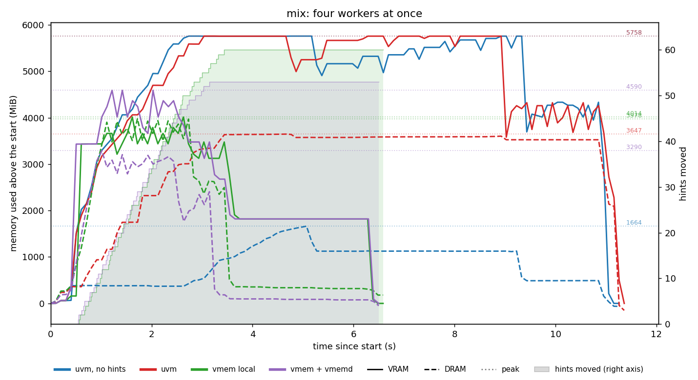

# libvmem test results

These are the measured results of the tests described in [README.md](README.md). All runs are on an RTX 4050 Laptop (5770 MiB of VRAM) with 15 GB of RAM and CUDA 13.0. Each configuration ran once.

## Findings

1. **Device memory from VMM is as fast as `cudaMalloc`.** When the data fits, the sharpen step takes 0.92 s on `vmem` and 1.04 s on `cuda`. Managed memory (`raw`, `uvm`) takes about five times longer, because every page faults on first touch.
2. **When the data does not fit, `vmem` gets through fastest.** `cuda` runs out of memory in every such run. With four processes sharing the GPU, the image test takes 3.4 s on `vmem` with the daemon, 4.7 s on `vmem` alone, 9.1 s on `uvm` and 17.9 s on `raw`. Under UVM the prefetch hints halve the time.
3. **The price is pinned host memory, and the daemon caps it.** On its own, `vmem` carries out every hint, 120 moves in all, and DRAM use climbs to 6.9 GB. With `vmemd`, the 3000 MiB host budget holds DRAM at 3.4 GB. The daemon refuses the 29 evictions that would go over the budget, and those images stay on the device, so 22 later prefetches find their image in place and only 69 hints move data. The copies it saves are why the daemon run is faster here.
4. **Sharing the GPU through the daemon does not change results.** In every four-process run on `vmem` with `vmemd`, every worker passed its spot checks, and the daemon's counts returned to zero when the workers exited.

## Four processes at once (`make trace-all`)

These traces are from 2026-10-21, one run per backend and workload. Each plot overlays the runs of one workload. The left axis shows VRAM (solid) and DRAM (dashed) above their values at the start, with a dotted line at each peak. The right axis counts the hints that moved data in each `vmem` run, each step at the time the hint returned. A hint that is accepted but finds the image already in place (a prefetch after a refused eviction) moves nothing and is not counted. `raw` is labelled "uvm, no hints". `cuda` is left out because it ran out of memory in every workload. The CSVs and one plot per run, `cuda` included, are in [`analysis/`](../analysis/) as `WORKLOAD-BACKEND.csv`, `.events.csv` (one row per hint) and `.png`. Times are the length of the trace, so they include start-up.

| Image test | Time | Peak VRAM | Peak DRAM | Hints that moved data | Already in place | Refused |
|---|---|---|---|---|---|---|
| `raw` | 17.9 s | 5758 MiB | 3130 MiB | no hints | | |
| `uvm` | 9.1 s | 5758 MiB | 6544 MiB | 120 | 0 | 0 |
| `vmem` local | 4.7 s | 1972 MiB | 6875 MiB | 120 | 0 | 0 |
| `vmem` + `vmemd` | 3.4 s | 5070 MiB | 3391 MiB | 69 | 22 | 29 |

The two `vmem` runs move images at the same rate until the daemon's host budget fills. From then on the daemon refuses evictions, so its run stops at 69 moves while the local run goes on to 120. `raw` keeps the VRAM full for the whole run and lets the driver page images out on faults, which takes twice as long as `uvm`, where the hints move each image before it is used.

| Mix test | Time | Peak VRAM | Peak DRAM | Hints that moved data | Already in place | Refused |
|---|---|---|---|---|---|---|
| `raw` | 11.2 s | 5758 MiB | 1712 MiB | no hints | | |
| `uvm` | 11.5 s | 5758 MiB | 3669 MiB | 60 | 0 | 0 |
| `vmem` local | 6.6 s | 4014 MiB | 4448 MiB | 60 | 0 | 0 |
| `vmem` + `vmemd` | 6.6 s | 4590 MiB | 3566 MiB | 53 | 3 | 4 |

In the mix test the two GEMM workers hold their matrices while the two image workers stream. Both `vmem` runs take 6.6 s; the daemon refuses 4 evictions and keeps DRAM 0.9 GB lower. Under UVM the hints do not help here: `uvm` and `raw` take about the same time. We have not yet looked into why.

| GEMM test | Time | Peak VRAM | Peak DRAM |
|---|---|---|---|
| `raw` | 16.6 s | 5224 MiB | 308 MiB |
| `uvm` | 16.6 s | 5224 MiB | 428 MiB |
| `vmem` local | 15.8 s | 5626 MiB | 1111 MiB |
| `vmem` + `vmemd` | 15.7 s | 5226 MiB | 1597 MiB |

The GEMM test makes no hints, so `raw` and `uvm` run the same code and take the same time, and the `vmem` matrices stay where they were placed. Without the daemon, `vmem` fills the device and puts 1.1 GB on the host. With the daemon, its 5400 MiB device limit moves about 0.5 GB more to the host, at no cost in time. The workers finish one after another, smallest matrix first, because without MPS their kernels take turns on the GPU.

## One process

These runs are from 2026-10-20, made with the single-process `stress` program that the churn stress test has since replaced. It ran a matrix multiply and then the image workload; the image part now runs as `make test-workers-image ARGS="--workers 1 --image-mib 2404 --images 4 --passes 1 --backend BACKEND"`, with `--no-resident` for the rows without `--resident`. Each used four images of 2404 MiB and 8192 × 8192 matrices, and every run gave the checksum `12b62e4bb28`. With `--resident` the images need more than the VRAM.

| Mode | Total | Sharpen | Peak VRAM | Peak DRAM |
|---|---|---|---|---|
| raw | 6.99 s | 5.61 s | 4916 MiB | 146 MiB |
| cuda | 2.31 s | 1.04 s | 4814 MiB | 38 MiB |
| uvm | 6.15 s | 4.79 s | 4914 MiB | 51 MiB |
| vmem | 2.16 s | 0.92 s | 4814 MiB | 10 MiB |
| raw `--resident` | 41.21 s | 39.82 s | 5666 MiB | 5710 MiB |
| uvm `--resident` | 14.18 s | 12.78 s | 5666 MiB | 9320 MiB |
| vmem `--resident` | 9.60 s | 8.36 s | 4830 MiB | 7264 MiB |
| vmem `--resident`, with `vmemd` | 11.41 s | 10.18 s | 4828 MiB | 7015 MiB |
| cuda `--resident` | out of memory at image 2 | | | |

## Caveats

Every number comes from a single run. VRAM and DRAM cover the whole GPU and the whole machine, so other programs shift them; in the `raw` image and GEMM traces DRAM falls by 3 to 5 GB below its start; we have not found out what freed it. We have not measured how much time each daemon round trip costs. In the single-process stress test the daemon made `--resident` slower (11.4 s against 9.6 s), even though it also refused hints there; that run had no hint timing, so we cannot yet say where the time went.
